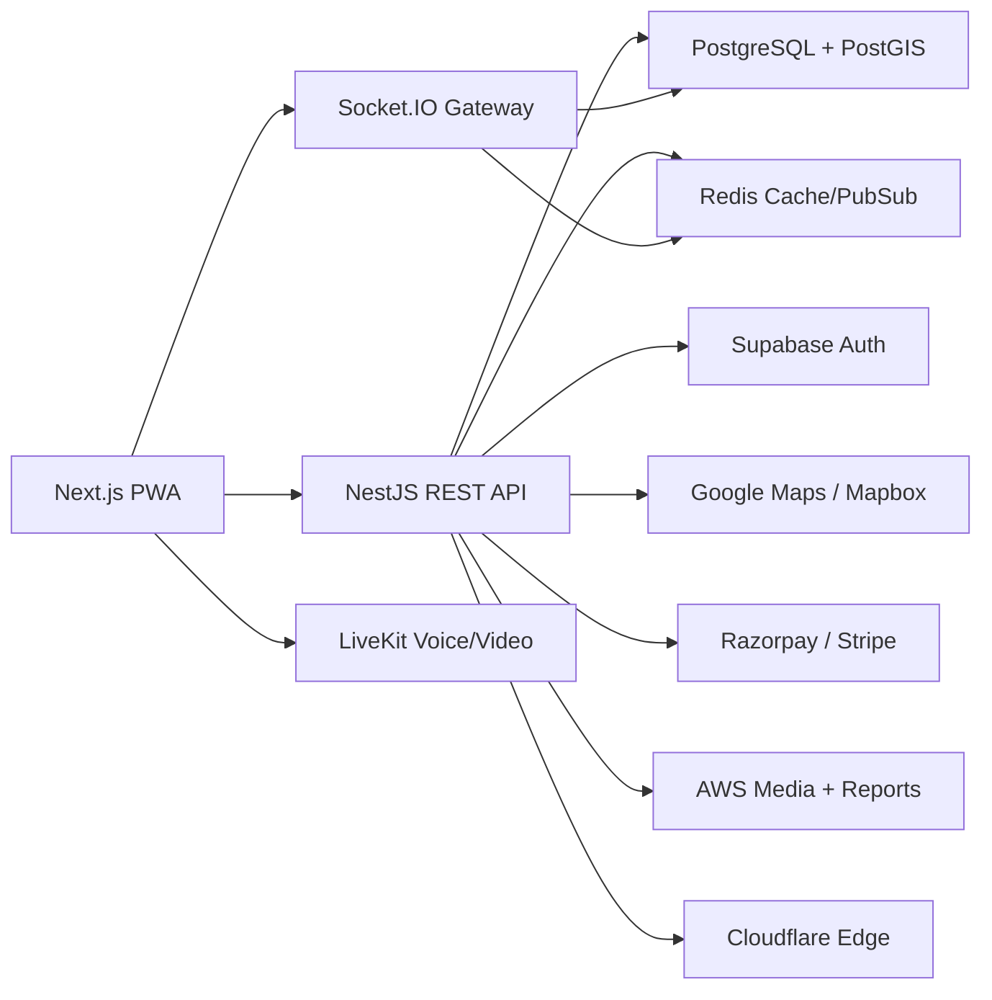

# Architecture

KAAFILA is split into a web-first PWA, a NestJS API, a realtime Socket.IO plane, LiveKit media rooms, PostgreSQL for source-of-truth data, and Redis for low-latency convoy state fanout.

## Core Domains

- Identity: Supabase handles email, Google, Apple, and mobile OTP auth. The API persists app profile, vehicle, subscription, emergency contact, and history records.
- Convoys: Rooms are created with invite codes and QR-compatible links. Membership supports owner, leader, sweeper, driver, family, and viewer roles.
- Tracking: Vehicles send GPS pings through REST or Socket.IO. Redis stores hot state with short TTLs while PostgreSQL records history for replay, analytics, alerts, and reports.
- Health: Separation, lost vehicle, route deviation, speed camera, checkpoint, toll, hazard, pit stop, and SOS alerts are normalized into `Alert`.
- Comms: Socket.IO carries low-latency push-to-talk signaling. LiveKit owns HD voice/video media transport for Pro rooms.
- Journey Engine: Journey recordings attach movement, stops, tolls, checkpoints, media, voice notes, reports, replay frames, and AI movie job metadata.
- Monetization: Explorer is free for every car. KAAFILA Drive is INR 500 per car per month (seats assigned per vehicle, entitlements evaluated server-side). See BLUEPRINT.md §4.
- Admin: Platform metrics, convoy monitoring, user/subscription management, moderation, ad inventory, reports, and revenue analytics use the same API surface with admin policies.

## Scale Model

- Hot path: WebSocket location events publish to Redis and fan out to convoy rooms in under a second.
- Durable path: Location pings are appended to PostgreSQL, then compacted into rollups and replay frames.
- Media path: Photos/videos/voice notes upload directly to object storage with signed URLs and are attached as `MediaAsset` rows.
- AI path: Assistant, reports, and trip movies should run async through queues so live convoy operations never wait on model processing.
- Regional growth: Deploy API workers near convoy clusters, keep Redis regional, and replicate analytics into a warehouse.
