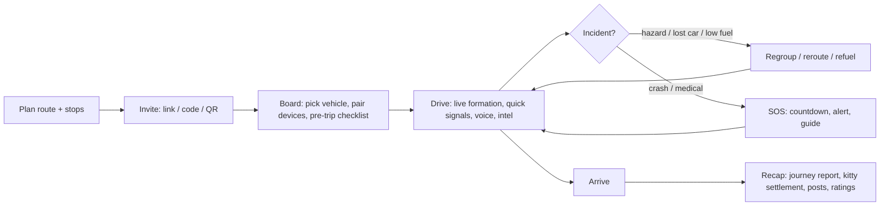
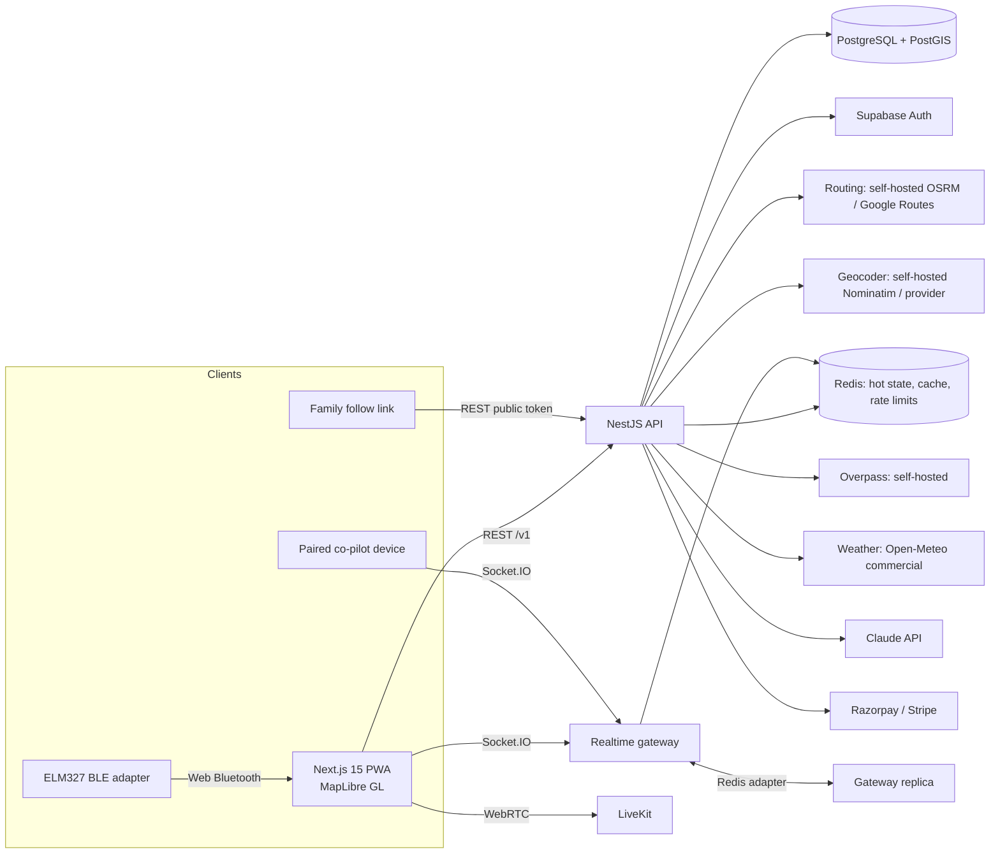

# KAAFILA — System Blueprint v2

Status date: 2026-11-26. This document is the single source of truth for what KAAFILA is, how it is built, and what is shipped versus planned. Every external constraint below links to its source. Anything marked **Roadmap** is not implemented yet.

---

## 1. Positioning (honest)

KAAFILA is a **group-driving operating system**: it keeps several cars, their drivers and their passengers coordinated from the moment a trip is planned until the last expense is settled.

It does **not** try to out-map Google Maps. Google has better base-map data, traffic and global POI coverage, and we say so. KAAFILA wins on what single-car navigation apps do not do:

| Problem on a group trip | Single-car nav apps | KAAFILA |
|---|---|---|
| "Where is everyone, and who fell behind?" | Location sharing, no formation awareness | Route-projected formation: order, gaps, convoy stretch, sweeper detection |
| "Leader is too fast, the tail is lost" | — | **Elastic Band** advice to the leader with a target speed delta |
| "Who runs out of fuel first?" | — | **Weakest-Link Range** planner across every car |
| "Where do we regroup?" | Search a place | **Fair Regroup**: the stop that minimises the worst ETA across scattered cars |
| "No signal on the ghat section" | — | **Dead-Zone Forecast** learned from past convoys' ping gaps |
| "Splitting fuel and tolls" | — | **Kitty**: shared ledger + minimum-transfer settlement + UPI links |
| "Family wants to follow" | Per-person sharing | Expiring, read-only **family follow link** for the whole convoy |
| "Crash on the highway" | Phone OS crash detection (some devices) | Convoy-wide SOS: countdown, leader + sweeper alerting, location, medical card |

## 2. Users and the convoy journey

Personas: **Organiser** (plans trips, pays for the group), **Driver**, **Co-driver/Navigator** (operates the app while the driver drives), **Family follower** (no account), **Club admin**, **Meetup host**, **Platform admin**.

Hands-free rule: while a vehicle is moving above 10 km/h, the driver's UI exposes only large one-tap controls (quick signals, PTT, SOS). Typing surfaces are for the navigator or for stopped vehicles. The assistant answers by voice where the browser supports `speechSynthesis`.

## 3. Feature catalogue

Legend: **Built** = implemented in this repository in this pass (API and/or web), **Roadmap** = designed, not implemented.

### 3.1 Convoy core
| Feature | Status |
|---|---|
| Create convoy with route (OSRM-compatible or Google Routes), invite code, join link, QR | Built |
| Membership roles: owner, leader, sweeper, driver, navigator, family, viewer; promote/remove | Built |
| Membership enforcement on every REST call and every socket room join | Built |
| Live tracking over Socket.IO with Redis hot state; durable pings in Postgres | Built |
| Route-projected formation (chainage, cross-track, gaps, stretch, auto-sweeper) | Built |
| Off-route detection (cross-track distance threshold) | Built |
| Breadcrumb "Ghost Leader" trail: the exact path the leader drove | Built |
| Quick signals (need fuel, washroom, slow down, pull over, I'm OK, flat tyre, …) with spoken read-out | Built |
| Convoy chat | Built |
| Regroup point set by leader, broadcast to all | Built |
| Socket.IO Redis adapter for multi-instance fan-out | Built (enabled when `REDIS_URL` set) |
| Voice: push-to-talk signalling (Socket.IO) + LiveKit token per member identity | Built (token); media UI Roadmap |
| Turn-by-turn voice navigation | Roadmap (native app) |

### 3.2 Signature intelligence (the "nobody does this" set)
| Feature | How it works | Status |
|---|---|---|
| **Elastic Band** | Stretch = lead chainage − tail chainage. Above thresholds the leader gets "ease off by N km/h"; above the hard limit the convoy gets a regroup prompt. | Built |
| **Weakest-Link Range** | Each car's usable range = fuel % × full-tank range − reserve. Convoy range = minimum. Recommends the last stop on the route before that car runs dry. | Built |
| **Fair Regroup** | For candidate stops, estimate each car's ETA; pick the stop minimising the *maximum* ETA (minimax), tie-break by total. | Built |
| **Dead-Zone Forecast** | Every gap > 60 s between a car's consecutive pings marks the geohash-6 cells along that segment. Cells with repeated gaps are surfaced ahead of the convoy so it regroups *before* the dead zone. Learned from our own traffic, so it improves with usage. | Built |
| **Convoy Pulse (fatigue)** | Continuous driving time per vehicle from pings; prompts a 15-minute break after 2 hours (common guidance from road-safety agencies, e.g. [NT Govt](https://nt.gov.au/driving/safety/fatigue-and-driving), [SA](https://mylicence.sa.gov.au/safe-driving-tips/fatigue), [Brake](https://brake.org.uk/get-involved/take-action/mybrake/knowledge-centre/driver-fatigue)). Thresholds configurable. | Built |
| **Crash-detect SOS** | `DeviceMotion` magnitude spike + speed collapse → 20-second cancellable countdown → convoy SOS with location and medical card. **Not a certified safety system**; it supplements, never replaces, calling emergency services. | Built (web heuristic) |
| **Kitty** | Shared expenses per convoy, equal/by-car/custom splits, minimum-transfer settlement (≤ n−1 transfers), `upi://pay` deep links. | Built |
| **Family follow link** | Signed random token, read-only, expiring, revocable; shows convoy positions only. | Built |
| **Co-pilot pairing** | Pair a second device (tablet on the dash, passenger phone) to a car with a 6-digit code/QR so the navigator operates while the driver drives. | Built |
| Convoy formation replay / trip story video | Roadmap |

### 3.3 Safety and roadside
| Feature | Status |
|---|---|
| Manual SOS with types (crash, medical, breakdown, security), acknowledge/resolve timeline | Built |
| Emergency numbers by country (curated, with source notes; "verify locally" disclaimer) | Built |
| Offline breakdown guides (flat tyre, overheating, dead battery, brake fade, accident scene, fire, flood, low fuel/charge, lost from convoy) cached by the service worker | Built |
| Nearby services by category (fuel, EV charging, hospital, police, mechanic, tyre, toilets, food, lodging) via Overpass, cached per geohash | Built |
| Community road reports (pothole, accident, police check, flooding, roadwork, debris, animal, fog, closure) with confirm/dismiss voting and auto-expiry | Built |
| Route weather (Open-Meteo-compatible) | Built (needs commercial key in production, see §7) |
| Web Push for SOS when app is backgrounded | Roadmap |
| Integration with official emergency dispatch | Roadmap (needs partnerships) |

### 3.4 Car care (Garage)
| Feature | Status |
|---|---|
| Vehicles with fuel type, tank/battery range, odometer, photos, showcase flag | Built |
| Maintenance log with cost | Built |
| Service reminders by date and/or odometer with interval auto-roll | Built |
| Document vault with expiry alerts (insurance, registration, pollution certificate, permit, FASTag, licence) | Built (metadata; file storage via signed URLs Roadmap) |
| Pre-trip checklist | Built |
| OBD-II over Web Bluetooth (ELM327 BLE): RPM, speed, coolant, fuel level, voltage, load, DTCs | Built (Chrome/Edge only) |
| Workshop marketplace / bookings | Roadmap |

### 3.5 Social, clubs, meetups
| Feature | Status |
|---|---|
| Profiles with handle, garage showcase, follows | Built |
| Clubs: create, join, public/private, club feed | Built |
| Posts, comments, likes, report content | Built |
| Meetups: create → admin review → published; capacity + waitlist; RSVP with vehicle; QR check-in code | Built |
| Paid meetup ticketing | Roadmap |
| Leaderboards / badges | Roadmap |

### 3.6 Assistant
In-journey assistant on Claude (`claude-opus-5-5`) with tools that read live convoy state: formation, intel, nearby services, weather, emergency numbers, breakdown guides, vehicle care status. Server-side fallback chain enabled. When `ANTHROPIC_API_KEY` is not set, a deterministic rule-based responder answers from the same intel so the feature degrades instead of failing. **Built**.

Why Messages API + tool use rather than Managed Agents: the tools are sub-second reads against our own database, no sandbox is needed, and in-car latency matters. Managed Agents remains an option for long-running, multi-step planning jobs (e.g. "plan a 7-day Ladakh trip for 12 cars").

### 3.7 Admin and controls
| Feature | Status |
|---|---|
| Live metrics from the database (users, live convoys, active cars, open SOS, MRR from active seats) | Built |
| Users: search, suspend/unsuspend, role change | Built |
| Convoys: live list, force-end | Built |
| SOS console | Built |
| Moderation queue: reports, road reports, posts (hide/restore) | Built |
| Meetup review: approve/reject | Built |
| Announcements (global or per country) | Built |
| Feature flags with percentage rollout | Built |
| Audit log for every admin mutation | Built |
| Revenue: MRR, seats, subscriptions by status | Built |

## 4. Pricing and billing

**KAAFILA Drive: ₹500 per car per month.**

| Plan | Price | Who it's for | Limits |
|---|---|---|---|
| Explorer | Free | Try it, occasional trips | Car can join convoys; 10 s location cadence; 7-day history; no assistant, no journey recording, no OBD telemetry history |
| **Drive** | **₹500 / car / month** | Every car that drives with KAAFILA regularly | 2 s cadence, all intelligence, assistant, journey recording + replay, OBD, garage reminders, 365-day history, family links, kitty |
| Fleet / Events | Custom quote | Tour operators, wedding fleets, corporate | Drive features + SLA, invoicing, bulk onboarding |

Mechanics:
- Seats are **per vehicle**. A buyer purchases N seats (Razorpay subscription `quantity` = N, or Stripe line item `quantity` = N) and assigns them to vehicles — their own or group members' (an organiser can sponsor a whole convoy).
- Entitlements are evaluated per vehicle on the server; the client never decides plan status.
- **Tax mode** is configurable: `PRICE_TAX_MODE=inclusive` (default — the customer pays exactly ₹500, GST is carved out) or `exclusive` (₹500 + 18% GST = ₹590). GST on SaaS is 18% ([India Briefing](https://www.india-briefing.com/news/gst-compliance-for-saas-and-cloud-computing-in-india-explained-39021.html), unchanged by GST 2.0). Confirm the SAC code and invoicing with a tax adviser.
- **RBI e-mandate rule**: recurring debits above ₹15,000 per transaction need additional authentication every time ([RBI Master Direction](https://rbi.org.in/Scripts/BS_ViewMasDirections.aspx?id=13374)). At ₹500 per car, a single subscription of 31+ cars crosses that line. The checkout warns and suggests splitting into several subscriptions or per-driver billing.
- India: Razorpay Subscriptions. International: Stripe Checkout with a Price configured in the dashboard (`STRIPE_PRICE_ID_DRIVE`) — we do not hard-code a converted USD price.
- Webhooks: Razorpay `X-Razorpay-Signature` = HMAC-SHA256(raw body, webhook secret) ([Razorpay docs](https://razorpay.com/docs/webhooks/validate-test/)); Stripe `constructEvent` over the raw body (NestJS `rawBody: true`, [NestJS docs](https://docs.nestjs.com/faq/raw-body)). Every event id is stored once for idempotency.

## 5. Architecture

### 5.1 Hot path (location)
1. Device emits `location:ping` (cadence by plan: 2 s Drive, 10 s Explorer; server rate-limits to that cadence).
2. Gateway validates JWT (handshake), membership and vehicle ownership/assignment.
3. Redis: `convoy:{id}:veh:{vid}` latest state (TTL 120 s), breadcrumb list for leader (capped 500 points), driving-session state for fatigue.
4. Fan-out `location:update` to room `convoy:{id}` (Redis adapter across replicas).
5. Durable insert into `LocationPing` (async, does not block fan-out).
6. Coverage learning: if gap since the previous ping > 60 s, upsert `CoverageCell` rows along the gap segment.

### 5.2 Intel path
`GET /v1/intel/convoys/:id` composes formation + elastic band + weakest-link range + fatigue + regroup suggestion + dead zones ahead from Redis state and the stored route polyline. Pure functions live in `packages/shared/src/intel` and are unit-tested; the API only gathers inputs.

### 5.3 Shared package
`packages/shared` ships ESM with explicit `.js` import specifiers so Node can load it at runtime (the previous build used extensionless specifiers and crashed the API at boot). It contains domain types, geo maths, convoy intelligence, settlement, pricing, OBD parsing, emergency data and guides.

## 6. Device connectivity model

| Capability | Android Chrome | Desktop Chrome/Edge | iOS Safari (PWA) | Firefox | Notes |
|---|---|---|---|---|---|
| Foreground GPS (`watchPosition`) | Yes | Yes | Yes | Yes | Needs HTTPS + permission |
| Background GPS | No (PWA) | No | No | No | Native app required — Roadmap (Expo) |
| Screen Wake Lock | Yes | Yes | Yes (16.4+) | Yes (recent) | Keeps the cockpit on |
| Web Bluetooth (OBD) | Yes | Yes | **No** ([caniuse](https://caniuse.com/web-bluetooth)) | **No** | iOS users need a native app or the Bluefy browser |
| Device motion (crash heuristic) | Yes | Device-dependent | Yes, after `requestPermission()` | Yes | |
| Web Push | Yes | Yes | Installed PWA only, 16.4+ ([WebKit](https://webkit.org/blog/13878/web-push-for-web-apps-on-ios-and-ipados/)) | Yes | Roadmap |
| Android Auto / CarPlay | — | — | — | — | Native only — Roadmap |

Pairing flow: owner opens **Connect → Pair a device** → server issues a 6-digit code (10-minute TTL, single use, rate-limited) bound to `{userId, vehicleId}` → second device enters code or scans QR → server records a `Device` row and returns its role (co-pilot display / passenger) → the device joins the convoy room as that vehicle's navigator.

OBD flow: user plugs a BLE ELM327 adapter into the OBD-II port (under the dashboard, driver side on most cars) → **Garage → Connect OBD** → browser device picker → we probe the common BLE UART services (`0xFFF0`, `0xFFE0`, and the Nordic UART service); clones vary, so the UI lets the user retry with another profile → ELM init (`ATZ`, `ATE0`, `ATL0`, `ATS0`, `ATH0`, `ATSP0`) → poll PIDs (SAE J1979 mode 01) → readings stream into the cockpit and, on Drive cars, are stored as telemetry.

## 7. Third-party providers and their limits

| Need | Development default | Production requirement | Source |
|---|---|---|---|
| Base map tiles | OpenFreeMap public styles (free, no key, "as-is", no SLA) | Keep OpenFreeMap with a self-hosted fallback, or MapTiler/Stadia | [OpenFreeMap](https://openfreemap.org), [ToS](https://openfreemap.org/tos/) |
| Routing | OSRM demo (`router.project-osrm.org`) | **Self-hosted OSRM/Valhalla** or Google Routes API. The demo server forbids heavy use and gives no guarantees | [OSRM policy](https://github.com/Project-OSRM/osrm-backend/wiki/API%20Usage%20Policy) |
| Geocoding | Nominatim public | **Self-hosted Nominatim** or a provider. Public instance: max 1 request/second total for the whole app | [Nominatim policy](https://operations.osmfoundation.org/policies/nominatim/) |
| POIs | Overpass public | **Self-hosted Overpass**. Public instances are around 10,000 requests/day per application | [OSM wiki](https://wiki.openstreetmap.org/wiki/Overpass_API) |
| Weather | Open-Meteo free | **Commercial Open-Meteo key** — the free API is non-commercial only | [Open-Meteo terms](https://open-meteo.com/en/terms) |
| Voice/video | LiveKit (self-hosted in compose) | LiveKit Cloud or self-hosted with TURN | |
| Auth | Supabase | Supabase | |
| Payments | Razorpay test / Stripe test | Live keys + webhook secrets | |
| AI | Claude API | Claude API | |

All provider base URLs are environment variables; the code never hard-codes a production dependency on a free public instance. The API sends an identifying `User-Agent` to OSM services as their policies require, caches every response in Redis, and rate-limits outbound calls.

## 8. Data model (Prisma)

Core: `User`, `Vehicle`, `Convoy`, `ConvoyMember`, `LocationPing`, `RouteCheckpoint`, `Alert`, `VoiceChannel`, `JourneyRecording`, `JourneyEvent`, `MediaAsset`.
Billing: `Subscription` (+ `quantity`, `unitAmountMinor`, `taxMode`), `SubscriptionSeat` (one per covered vehicle), `Payment`, `WebhookEvent` (idempotency).
Car care: `MaintenanceRecord`, `ServiceReminder`, `VehicleDocument`, `VehicleTelemetry`.
Devices: `Device`, `DevicePairing`.
Convoy extras: `ConvoyMessage`, `ShareLink`, `SosIncident`, `Expense`, `ExpenseShare`, `CoverageCell`.
Social: `Club`, `ClubMember`, `ClubConvoy`, `Post`, `PostComment`, `PostLike`, `Follow`, `RoadReport`, `RoadReportVote`, `Report`.
Meetups: `Meetup`, `MeetupRsvp`.
Platform: `AuditLog`, `Announcement`, `FeatureFlag`, `AdImpression`, `AssistantMessage`.

## 9. Security and privacy

- Every REST route except health, public share-link reads and payment webhooks requires a Supabase JWT. The dev bypass token works only when `NODE_ENV !== "production"` **and** `ALLOW_DEV_TOKEN=true`.
- Socket handshake verifies the JWT; `convoy:join` and every emit check membership; location pings are accepted only for a vehicle the user owns or is assigned to in that convoy.
- Suspended users are rejected at the guard.
- Location is personal data: exact tracks are stored only for convoy members and shown to family only via an explicit, expiring link. Personal data export is **Built** (`GET /users/me/export`). Plan-based retention (Explorer 7 days, Drive 365 days) and self-service account deletion are **Roadmap** and must ship before public launch. Align processing with India's DPDP Act 2023 and GDPR for EU users.
- Medical card fields (blood group, notes) are shared only inside an active SOS.
- Rate limits: global throttler + per-route limits on invite join, pairing codes, SOS, road reports and assistant calls.
- Admin mutations are written to `AuditLog`.
- Webhooks verify signatures over the raw body before any state change.

## 10. Scale targets

| Metric | Target |
|---|---|
| Ping → other cars' screens (p95, same region) | < 1 s |
| Vehicles per convoy | 1,000 (UI virtualises the roster beyond 50) |
| Concurrent convoys per gateway replica | ~2,000 at 2 s cadence (load-test before launch) |
| API availability | 99.9% |

Scale levers: horizontal gateway replicas behind sticky sessions + Redis adapter; `LocationPing` partitioned by month with retention jobs; read replicas for analytics; regional deployments for Gulf/US clusters.

## 11. Deployment

- Web: Vercel (`bom1`, `sin1`) or Hostinger Node; API + gateway: containers (Fly.io/Render/AWS ECS) with ≥ 2 replicas; Postgres 16 + PostGIS (managed); Redis 7 (managed); LiveKit.
- Self-hosted map services (OSRM, Nominatim, Overpass) on one 64 GB box covering India to start; add regions on demand.
- CI: install → prisma validate → shared tests → typecheck → build.

## 12. Verification (this pass)

- `packages/shared`: 31 unit tests pass (geo, intelligence, settlement, pricing, OBD parsing, garage, roadside).
- Database: both migrations applied to a real PostgreSQL; `prisma migrate diff` reports no drift.
- API: typecheck, build, and a 15-flow end-to-end smoke test (`apps/api/test/smoke.test.mjs`) over HTTP and Socket.IO against that database.
- Web: typecheck and production build of all 19 routes; the Drive demo, landing and Roadside pages were checked in a browser with live OpenFreeMap tiles.
- Not verified yet: real Redis (mocked locally; CI uses Redis 7), Docker images, live Supabase/Razorpay/Stripe/LiveKit/Claude calls, physical OBD adapters, background behaviour on phones, load. See `docs/DEPLOY_CHECKLIST_STATUS.md`.

## 13. Roadmap

1. **Now (this pass)**: everything marked Built above, web and API.
2. **Before public launch**: location retention job + `LocationPing` partitioning, self-service account deletion, Web Push for SOS, load test of the socket tier, self-hosted geo services.
3. **Next**: Expo native apps (background GPS, push, CarPlay/Android Auto), LiveKit media UI, media uploads to object storage.
3. **Later**: workshop marketplace, paid meetup ticketing, AI trip-story videos, dispatch partnerships, fleet invoicing portal.
